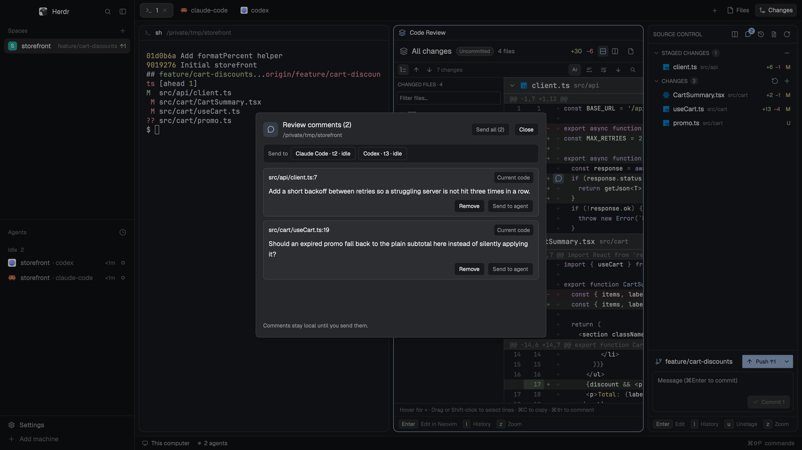

# Herdr Code Review

Formerly **Tabbed Changes**. The internal mod ID remains `tabbed-changes` for existing installations.

**Review code, leave inline feedback, and send it straight to your coding agent in [Herdr](https://herdr.dev).**

A VS Code-style Source Control mod with branch switching, explicit upstream push/pull controls, comparisons against `origin/main` or `origin/master`, tabbed diffs, and compact review comments on lines or ranges. Review a change, select the code, and send the original snippet with your instructions to an agent running in Herdr.


## Review with your agent

1. Open a changed file or a file tab.
2. Hover over a line and click the **+** beside its number to comment. Double-click a line to select the row and keep its **+** visible. In a diff, drag across code rows to select a range, or click the first line and **Shift-click** the last.
3. With a line or range selected, click its **+** or press **⌘⇧I** to open or focus the comment box.
4. Write your feedback and click **Save comment**. The card switches to your saved notes. Choose **New comment** to write another.
5. Choose an idle agent in the same Herdr space, then click **Send to agent** on the saved comment.

Press **Esc** to close an inline thread. Reopen it to continue your draft.

Open **Comments** at the bottom of Source Control to see every saved comment for the current repository. Each entry shows its file, line range, and code version, with actions to send it to an idle agent or remove it.

The message includes the repository, file path, line range, old/new side, code snapshot, and your feedback. Sending submits it immediately. A successful send removes the comment; a failed send keeps it for retry. The mod never interrupts agents or forces past their prompts.

### Comments stay with the code

- **Inline threads:** compact boxes beneath the selected code, in file views and inline or side-by-side diffs.
- **Comment placement:** in a side-by-side diff, click the code or gutter on the version you want to comment on. Inline diffs attach comments on removed lines to the original code and other comments to the current code.
- **Line ranges:** up to 500 consecutive lines in the same file and side. Ranges cannot cross hidden diff gaps.
- **Gutter badges:** a speech bubble identifies lines with saved comments. A strong accent band and solid edge mark the rows selected for a comment.
- **Changed-code warnings:** amber badges and an **Outdated** label flag snapshots that no longer match the displayed code.
- **Local persistence:** saved notes are scoped to repository and machine in Herdr shared state. Drafts survive switching lines within an open tab.
- **Original context:** saved comments retain their original code and line numbers; they are not automatically relocated when code moves.

Local file views watch for relevant changes and use a 10-second fallback refresh. Diff views use their existing folder watch and refresh cycle. Agent delivery targets agents running **inside Herdr**, not an external Codex desktop chat.

## Navigate and inspect diffs

In **All changes**, the **Files** icon toggles a changed-file tree. Filter by filename or path, fold folders, and click a file to jump to its diff. File navigation uses the loaded diff without running Git again. Single-child folder chains share one row (`src/utils/format`), each file shows its `+N −N`, and the panel is resizable by dragging its divider.

- **Previous/next change:** toolbar arrows or **Alt+Up / Alt+Down** jump between diff hunks and wrap at the ends.
- **Copy:** select lines (click, or drag / Shift-click a range) and press **⌘C**, or use **Copy** in the selection bar, to copy the plain code without line numbers or `+`/`−` markers. With nothing selected, **⌘C** copies the current line.
- **Sticky file header:** in All changes, the current file's name and `+N −N` stay pinned at the top while you scroll its diff; click it to jump to the file's start.
- **Find:** **⌘F** opens case-insensitive text/path search within the loaded diff. Enter/Shift+Enter and the search arrows move between matching rows. Searching expands folded files; matches have an amber row marker.
- **Words:** on by default. Changed words inside paired removed and added lines are highlighted; words separated by a space merge into one block, and a mostly rewritten line keeps only its line tint instead of a box on every word. Unusually large lines use a whole-line highlight.
- **Ignore spaces:** hides whitespace-only changes, for both local and origin comparisons. Git's filtered context does not retain exact original whitespace, so original-side comments on unchanged context rows are unavailable in this mode. Turn it off to comment on those rows. Removed lines and current-side comments remain available.
- **Show more lines:** expands the unchanged code around each change from three lines to ten. **Show fewer lines** returns to the compact view. Selections and drafts remain available when their lines are still visible.
- **Wrap lines:** off by default, so long lines scroll sideways and code keeps its exact shape; turn **Wrap lines** on to fit them to the pane. In split view with wrapping off, both columns stay half the pane and slide together (trackpad swipe or Shift+wheel); with it on, each side wraps within its own column, and wrapped rows hang two columns past the line's own indent. **⌘⇧I** reveals or focuses the comment input.

Search and navigation respect the 8,000-row display limit. They do not edit files, fetch, switch branches or push.


### Responsiveness

Folder-watch bursts are coalesced for 150ms. Overlapping read-only Git commands reuse a bounded 400ms cache keyed by repository, machine and arguments; repository operations invalidate it. Unchanged diffs retain their built rows, and file views reuse line contexts and layout sizes. Local file watchers provide updates with a 10-second fallback refresh; unchanged polls do not redraw the file or its comment editor. Syntax tokens and word highlights use bounded caches. Git writes are never cached.

Automated checks verify **two overlapping reads → one command load**, **25 watcher events → one scheduled refresh**, and no row rebuild for an identical diff reload. An optional synthetic benchmark (`npm run benchmark`) compares comment-badge processing with commit `efdc50b`. On one run with 20,000 lines, 50 comments and four passes, the helper took **206.83ms before / 3.18ms after** indexing. This is a helper benchmark, not a measurement of overall Herdr latency or frame rate.

## Commit history

Use **History** in the bottom shortcut bar to browse the current HEAD, newest first, in pages of 50 commits. Open a commit to inspect its changed files, then review one file or **Review all files** in the diff tab. Root commits compare against the empty tree; merges compare against their first parent.

Historical diffs are read-only snapshots of commit objects: staged and working-tree edits never appear in them. Editor actions and inline working-tree comments are unavailable there. Existing inline/split layout, search, context and whitespace controls remain usable.

### Where diffs open

Clicking a file in Source Control (or moving the selection with `j` / `k`) shows its diff in a **split pane beside the pane you are working in**, not in a new tab, and reuses that one pane for the next file. The panel keeps the keyboard, so `j` / `k` / `s` / `u` keep working after a click. Zoom the pane with `z` (or `⌘⇧Enter` on it). Double-click a file for a pinned review tab of its own. To get one reusable diff *tab* instead, set Herdr's shared key `tabbed-changes.open` to `"tab"`.

The diff header carries a **scope chip** (Staged, Unstaged, New file, Conflict, Uncommitted) so you can tell which diff you are looking at; comparisons against a branch and historical commits say so in the title instead. In a narrow pane the header's text buttons (All changes, Open file, editor, Local changes) collapse to icons with tooltips. Modified files use an amber status letter, added/untracked green, deleted red.

### Scoped review shortcuts

Bottom keycaps wrap to fit Source Control, diff, file-preview and history views, and dim while that view does not hold the keyboard (Source Control also draws an accent border while it does). Unavailable actions are disabled; text inputs and modified chords keep their existing behavior. These are review-view bindings, not global terminal bindings.

| Key | View | Action |
|---|---|---|
| `j` / `k`, Down / Up | Source Control or history | Move the selection. |
| Enter | Source Control, working diff or file preview | Edit the selected working file or line. |
| `l` | Source Control, diff or file preview | Open commit history. |
| `s` / `u` | Source Control | Stage / unstage the selected whole file when available. |
| `z` | Source Control or diff pane | Zoom the diff pane to the full tab area (and back). Same as the pane header's zoom button or `⌘⇧Enter` on the focused pane. |
| Enter | History | Open the selected commit, file or all-files review. |
| `l` / Esc | History | Return to commits, or close history from the commit list. |

### Selecting lines

Drag across diff rows to select a range. Dragging toward the top or bottom edge scrolls the diff and keeps extending the selection; leaving the rows no longer cancels it. A range stops at the last row it can legally reach (it cannot cross hidden gaps or a file boundary, and is limited to 500 lines) instead of freezing.

### Sending comments

Open **Comments** at the bottom of Source Control. **Send all (N)** delivers every saved comment as one message, ordered by file and line, to the chosen agent; a single available agent is chosen for you, with several you pick one. Delivery waits for the agent to be idle or finished, and the comments are removed only after it succeeds.

## Branch switching and Git actions

Click the **branch name and chevron** in Source Control to open a searchable branch picker. Beside it, a single comparison control shows the detected `origin/main` or `origin/master`. Local branches switch in place; remote branches create a local tracking branch when one does not exist. The picker identifies the current branch and branches checked out in other worktrees. If a local branch with the same name tracks a different remote branch, select that local branch explicitly rather than silently changing its upstream.

Switching uses normal `git switch`: compatible uncommitted changes can carry over, and Git refuses a switch that would overwrite them. The mod does not force checkout, discard changes, or auto-stash.

The sync row below **Comments** at the bottom of Source Control says in words what will happen, then offers the matching action:

- **Status line:** `↑2 commits to push to origin/main`, `↓1 commit to pull from origin/main`, `Up to date with origin/main`, `Diverged: ↑1 ahead, ↓1 behind origin/main`, or `feature-x is not on origin yet`.
- **Primary button** follows the state: **Push ↑N**, **Pull ↓N**, **Publish branch**, or a disabled **Up to date** / **Diverged**. Hover it for exactly what it will do.
- **Fetch** updates remote refs without merging. **Pull** is fast-forward only, without automatic stashing, and is off while the branch has diverged.
- **Protected branches:** pushing to `main`, `master` or the default branch needs a second click (`Push ↑2 straight to main? Click again to confirm`, with **Cancel**); other branches push at once.
- **Result:** a green line (`✓ Pushed 2 commits to origin/main`) shows for a few seconds; failures stay in red under the list.

Ahead/behind counts appear beside the branch name. Push and Pull recheck the current branch and upstream before acting; if either changed, refresh first. Push uses an explicit branch refspec and does not push unrelated branches or tags. Origin comparisons do not change the push destination. There is no force-push action.

## Compare with origin/main or origin/master

Use the **default-branch comparison control beside checkout** at the top of Source Control to review your branch against the remote default branch. The mod uses `origin/HEAD` when it points to `main` or `master`, otherwise prefers `origin/main` and falls back to `origin/master`.

The diff compares the working tree with the last commit shared by your branch and the fetched default branch (their Git merge base). This includes committed changes, staged and unstaged edits, deletions, and untracked-file previews. Commits that land only on the default branch stay out of your review. Use **Local changes** to return to local review, or double-click an All changes file header to open that file's diff.

**Fetch origin** explicitly runs `git fetch --no-tags origin` to update remote-tracking refs. Viewing a comparison does not fetch automatically, merge, switch branches, or push. If the requested remote branch has not been fetched or does not exist, the view shows an explanation. Old-side comments retain their branch and commit snapshot so feedback from different comparison bases stays separate.

## Source Control features

| Feature | Behavior |
|---|---|
| Source Control panel | Follows the focused terminal or review repository, including pinned/file tabs after reload. Merge, Staged, and Changes sections; file icons; added/deleted counts; stage, unstage, confirmed discard, commit, push, pull, and publish branch. |
| Branch switching | Search local and remote branches; create tracking branches; protect conflicting local edits. |
| Upstream Git actions | Fetch, fast-forward Pull, current-branch Push, Publish branch, and ahead/behind counts. |
| Remote comparison | Review branch changes and local edits since the last shared commit with `origin/main` or `origin/master`. |
| Commit history | Paginated HEAD history, changed-file lists, and immutable single-file or all-files commit reviews. |
| Inline feedback | Comment on lines/ranges, show gutter badges and outdated warnings, and send context to a Herdr agent. |
| Tabbed diffs | Single-click reuses the **Changes** tab. Double-click pins a separate tab labeled with the filename. |
| All changes | Review changed files in one scrolling view with collapsible file headers. |
| Inline and side-by-side diffs | Old/new line numbers, added/deleted highlights, and syntax coloring. |
| File views | Whole-file previews with added, modified, and deleted-line gutter markers. |
| Neovim integration | Reuses the selected Herdr tab's persistent embedded editor with your configuration, LSP, plugins and keymaps. **⌘-click** also opens lines with a working-file counterpart. |
| File-type icons | Material Icon Theme icons in the panel and tab headers. |

### Review views





[All changes screenshot](docs/screenshots/all-changes.png) · [Neovim example](docs/screenshots/neovim.png)

## Install

Requires Git 2.x with `git switch` support, a compatible Herdr app, and its `herdr-core` CLI on PATH for read-only review-pane metadata lookup. Developed and checked on macOS with Herdr 0.1.12. Neovim is optional; it is only needed for the editor action.

From this repository:

```sh
mkdir -p ~/.config/herdr-app/mods
cp -R mods/tabbed-changes ~/.config/herdr-app/mods/
herdr-app check ~/.config/herdr-app/mods/tabbed-changes
```

Herdr's shipped layouts are read-only. Clone your layout:

```sh
herdr-app do layout.clone '{"name":"main","as":"tabbed-changes"}'
```

In `~/.config/herdr-app/layouts/tabbed-changes.json`, change the existing Changes block's `"mod": "changes"` to `"mod": "tabbed-changes"`. Keep the rest of the layout intact.

If your layout uses a pane header, set its `header.content` to `{"mod":"tabbed-changes","props":{"role":"pane-header"}}` to show **Code Review** over review panes.

The internal mod ID, folder, layout references, asset paths, and saved-state keys remain `tabbed-changes` for compatibility with existing installations.

### Use another terminal editor

The local default is `nvim`, using the existing `herdr-nvim` companion rather than creating a terminal tab for each file. Set Herdr's shared key `tabbed-changes.editor` to an executable such as `vim`, `hx`, or an absolute executable path to choose another editor. A custom editor, a remote source, or an absent companion uses the plain terminal-editor path. A failure from an installed companion is reported instead of silently opening another tab. This mod does not provide its own LSP client.

## Development and validation

```sh
npm test
npm run check:herdr
# Optional synthetic helper benchmark:
npm run benchmark
```

No npm dependencies are required. The nine test scripts cover Git parsing, syntax coloring, icons, line/range context, comment scoping, stale snapshots, guarded delivery, history pagination/root/merge commits, unusual paths/metadata, immutable patches and context-expansion boundaries, scoped keyboard decisions, and repository selection for pinned/file/preview and standalone Source Control tabs. `check:herdr` loads the real mod once; it does not exercise every deferred row or interaction. See [RECIPE.md](RECIPE.md) for implementation details and [docs/PUBLISHING.md](docs/PUBLISHING.md) for publishing.

Automated live checks opened history without native runtime errors and exercised Enter through the installed mod: the selected file opened at line 1 in the same existing Neovim window, with no added or removed terminals. The original editor buffer, cursor, viewport, layout and focus were restored. Native icon installation passed its staged check and a second installation was a no-op.

Visual/pointer verification is not claimed: Herdr's screenshot API returned a cached frame during this pass. A real idle-agent delivery still needs end-to-end verification; send success/failure and cleanup rules remain covered by tests.

## Limits

- Whole-file staging; no hunk or selected-line staging.
- Up to 1,000 files in the panel, 8,000 diff rows, and 40 untracked-file previews in All changes.
- File previews are capped at 400,000 characters and 20,000 lines.
- Context expansion and search remain bounded by the diff-row limit; very large word diffs fall back to whole-line highlighting.
- Syntax coloring is line-based, so multiline comments and strings are approximate.
- At most 10,000 characters per comment and 60,000 characters per delivery message.
- Saved comments can become outdated; the recipient must verify the snapshot against the current code.

## Credits and license

MIT: see [LICENSE](LICENSE). File icons are from [Material Icon Theme](https://github.com/material-extensions/vscode-material-icon-theme), under its included [MIT license](mods/tabbed-changes/icons/files/LICENSE.txt). Other icons are Lucide-style SVGs (ISC). Inspired by [herdr-git-changes](https://github.com/aBER0724/herdr-git-changes) and Zed's Git panel; no code copied.
