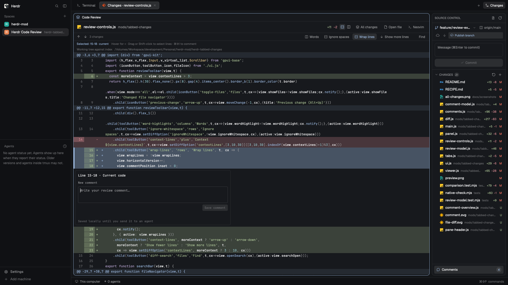
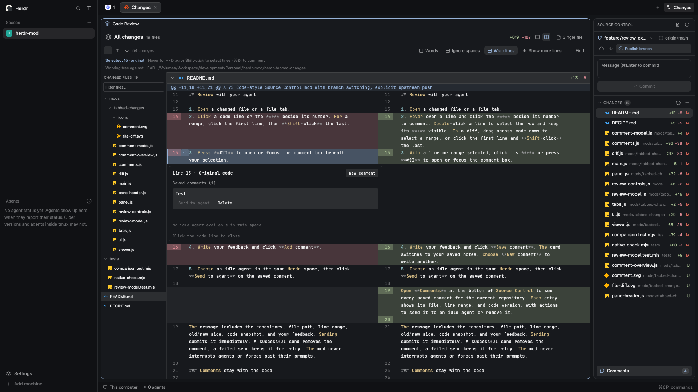
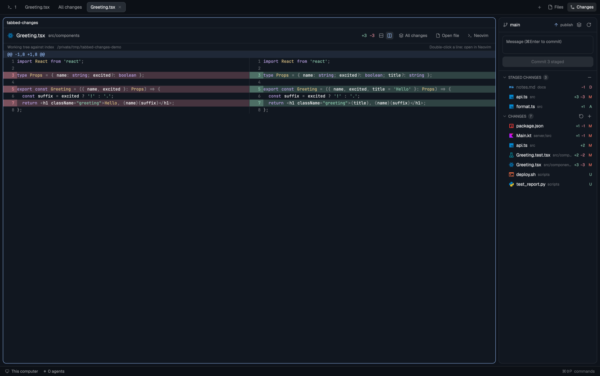
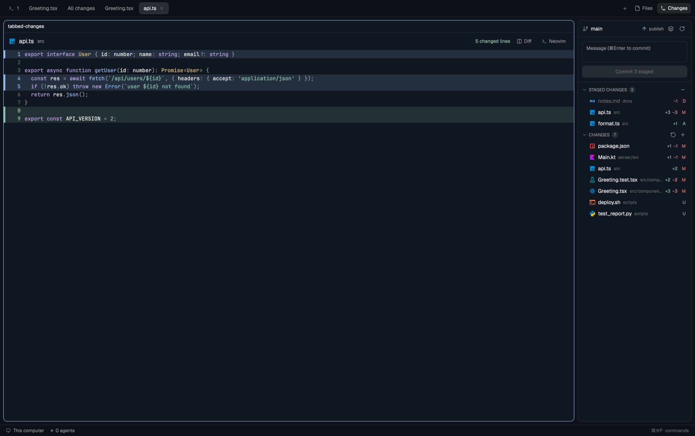
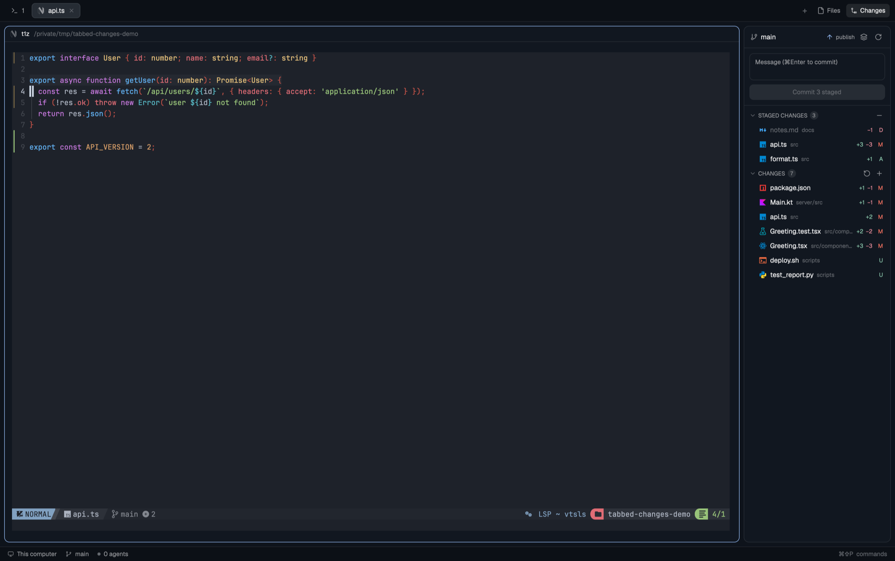

# Tabbed Changes

A VS Code–style **Source Control** panel for [Herdr](https://herdr.dev) where every file opens in a **tab** instead of inline. Click a change to see its diff, view every change at once, open the file with git markers in the gutter, or jump straight into Neovim at the line you care about.


## Features

| | |
|---|---|
| **Source Control panel** | Merge / Staged / Changes sections, file-type icons, `+N −N` counts, stage / unstage / discard (asks first), commit box (⌘↩), push / pull / publish. |
| **Diff in a tab** | Single click reuses one *preview* tab (like VS Code); double-click opens a pinned tab of its own. |
| **All changes** (multibuffer) | Every changed file stacked in one scrolling tab, Zed-style. Click a file header to fold it, double-click to drill in. |
| **Inline or side by side** | Old/new line numbers, bold red/green lines, syntax-highlighted code. |
| **File tab with git gutter** | The whole file with green (added), blue (modified) and red (deleted-here) markers and tinted lines. A **Diff** button jumps to that file's diff. |
| **Open in Neovim** | Hover a row, or double-click any diff line, to open `nvim +LINE file` in a new tab: your own LSP, plugins and keymaps. A missing editor prints an install hint instead of failing silently. |
| **File-type icons** | 34 Material Icon Theme icons in the panel and every tab header. |







### Why Neovim and not built-in LSP?
Herdr's code widget has no language-server client, so rather than half-build one the mod opens your editor, where LSP already works. Use another editor by setting the shared key `tabbed-changes.editor` (e.g. `vim`, `hx`).

## Install

```sh
cp -R mods/tabbed-changes ~/.config/herdr-app/mods/
herdr-app check ~/.config/herdr-app/mods/tabbed-changes
```

Herdr's own layouts are read-only, so clone one and point its `changes` block at the mod:

```sh
herdr-app do layout.clone '{"name":"main","as":"tabbed-changes"}'
# then in ~/.config/herdr-app/layouts/tabbed-changes.json change  "mod": "changes"  to  "mod": "tabbed-changes"
```

Needs git 2.x and a recent Herdr (developed on 0.1.x, macOS).

## Development
`npm test` runs the pure helpers (`git.js`, `highlight.js`, `fileicons.js`) under node. `herdr-app check mods/tabbed-changes` loads the mod once. See [RECIPE.md](RECIPE.md) for how it is built.

## Limits
Whole-file staging only; 1,000 files in the panel; 8,000 diff rows and 40 untracked files in All changes; side-by-side has no sideways scroll; syntax colouring is per line, so multi-line comments and strings are approximate.

## Credits & licence
MIT (see `LICENSE`). File icons are from [Material Icon Theme](https://github.com/material-extensions/vscode-material-icon-theme) (MIT, `mods/tabbed-changes/icons/files/LICENSE.txt`). Other icons are Lucide-style SVGs (ISC). Inspired by [herdr-git-changes](https://github.com/aBER0724/herdr-git-changes) and Zed's git panel; no code copied.

## Review comments for agents

Click a code line or the **+** beside its line number in a diff or open-file tab. A comment box opens **directly beneath that line**, alongside the code. Write your note and **Add comment**. Choose an idle Herdr agent in the same space, then use **Send to agent** on that note. It sends the file path, line number, old/new side, code snapshot and your comment together, and submits immediately.

Saved comments stay attached to their individual lines in Herdr's local shared state, scoped to repository and machine. Click a commented line to reopen its thread. Sent notes remain visible; failed sends remain pending. Unfinished drafts survive switching lines within the same open tab. In side-by-side diffs, click the relevant half or choose Old side / New side. Line numbers and code are snapshots; the agent must check the current file. Single lines only. Agents must run inside Herdr; this does not send to an external Codex desktop chat. No agents are interrupted or forced past a prompt.
