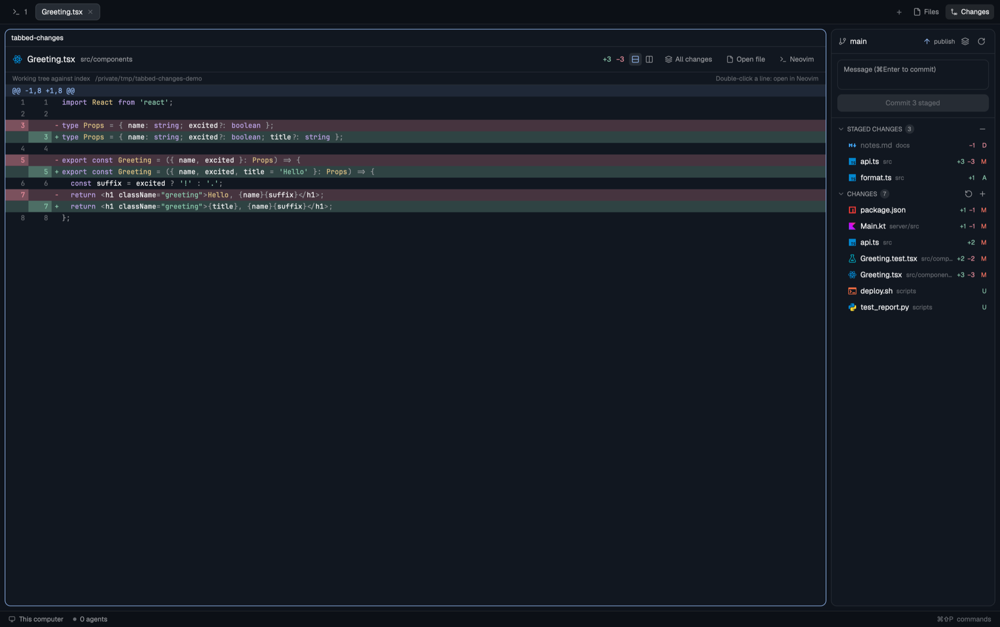

# Tabbed Changes

A Source Control panel (like VS Code's) whose files open in tabs: diffs, whole-change multibuffer, plain file views and Neovim. 

## What you see
- **Panel** (dock where Herdr's `changes` block sits): 42px header (branch icon, branch, ↑/↓ counts, layers "all changes", refresh), commit box (textarea + `Commit N staged` button), then sections MERGE CHANGES / STAGED CHANGES / CHANGES with 26px rows: name, folder in `dim`, `+N −N`, status letter (`blocked` M, `ansi2` A/U, `ansi1` D/!).
- **Diff tab**: 38px header (icon, name, folder, `+N −N`, inline/side-by-side pair, All changes / Single file, Open file, Neovim), 22px caption (what is compared, repo path), then 20px rows with two 40px number gutters.

## How it behaves
- Row click: preview diff tab (made once per space, renamed and reused; `shared("tabbed-changes.view")[space] = {view, tab, at}`). Double-click: pinned tab (`props.pinned`).
- Hover row: Neovim, Open file, Discard (asks), Stage/Unstage.
- Diff: double-click a line opens `nvim +LINE file` in a new tab (`tab.new {argv, folder}`); file header rows fold; double-click header goes to single-file.
- Staging moves the file between sections; the preview follows it.

## Built from
`main.js` picks `props.role`: none = panel, `diff`, `file`. `git.js` (pure: status, numstat, diff rows, side-by-side pairing, patch splitting, editor argv), `tabs.js` (tab opening, editor lookup), `panel.js`, `diff.js` (virtual list, clicks via `on_item_click` + click count from `on_mouse_down`), `viewer.js` (`Editor`, readonly), `ui.js`, `icons/` (Lucide-style SVGs). Herdr API: `exec`, `watchFolder`, `readTextFile`, `shared/setShared`, `run("tab.new"|"tab.rename"|"tab.select")`.

## Watch out
- `run` returns nothing: find the new tab by diffing the space's tab ids.
- Virtual-list rows cannot hold handlers.
- Reads use `--no-optional-locks -c core.fsmonitor=false` so the folder watch doesn't loop.
- A diff tab is a mod pane with no folder: the panel must keep its repo while it is focused.

## Done when
`herdr-app check` passes; `npm test` passes; clicking a file opens a tab named after it, a second click reuses it, double-click opens another; All changes lists modified and untracked files; Neovim opens at the clicked line.
